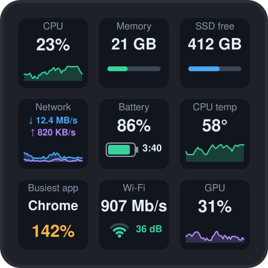

# Util Keys

> [!NOTE]
> **Moved to [Keybo](https://github.com/vicsz/keybo).** Util Keys and Claude Keys are now one plugin, Keybo: the same
> keys, plus a pixel robot that keeps an eye on your Mac and your agents. Get it from
> [Keybo's releases](https://github.com/vicsz/keybo/releases/latest). This repo is archived.

**Live Mac system stats on a Logitech MX Creative Keypad, like iStat Menus on your desk.**

Stats keys that update every second, plus Mic and Keep awake switches and a Pomodoro timer. Only Busiest app, Connection, Mic, Keep awake and Pomodoro do anything when tapped (see below).

## Keys

| Key | Shows | Colour |
|---|---|---|
| CPU | Load across all cores, and the last minute as a graph | Green, amber over 70%, red over 90% |
| Memory | GB used, as Activity Monitor counts it. The bar is memory pressure | The bar follows pressure: green, amber, red |
| SSD free | Free space on the startup disk, as Finder shows it (purgeable space counts as free). The bar is space used | Blue, amber under 15% free, red under 5% |
| Network | Download and upload speeds, each with a graph of the last minute | Blue down, purple up |
| Disk | Read (R) and write (W) speeds across all disks, each with a graph of the last minute | Blue read, purple write |
| Battery | Charge, and beside the icon the time left (h:mm), or time to full with a bolt while charging | Green, amber under 20%, red under 10% |
| CPU temp | CPU temperature, and the last two minutes as a graph | Green, amber from 80°, red from 95° |
| Busiest app | The app using the most CPU, then its icon in a ring, and its CPU. The ring fills at one full core (100%). Helpers count toward their app, so Chrome Helper counts as Chrome. A process that isn't part of an app shows a plain terminal tile. Tap to open Activity Monitor | Ring green, amber over 100% |
| Connection | Ethernet or Wi-Fi and its link speed. With both connected it shows Ethernet, and a tap switches to Wi-Fi and back. On Wi-Fi, the Wi-Fi symbol and the number beside it are the signal above the noise, in dB, so a noisy room costs arcs | Wi-Fi: green from 25 dB, amber from 15 dB, red below. Red when offline |
| GPU | GPU load, and the last minute as a graph | Purple, amber over 70%, red over 90% |
| Mic | The default microphone: Live while an app is recording from it, On while it's free, Muted when muted. Tap to mute or unmute | Red while live, green while on, grey while muted |
| Pomodoro | A 25-minute timer. Tap to start, tap to pause, tap to carry on; hold to reset. The ring round the tomato fills as time runs, and when it's full a sound plays and the key stays Done until tapped | Ring green, amber for the last 2 minutes, grey while paused; the key glows green when done |
| Keep awake | A switch: tap to stop the Mac sleeping on its own, tap again to allow it. The screen can still turn off. While on, the cup steams. It starts off whenever the plugin loads | Green cup while on, grey while off |

Each key shows a label, one value and at most one graphic.

The keys only read the system while one of them is on the keypad.

## Install

You need a Mac, Logi Options+ (signed in to a Logi account) and an MX Creative Keypad.

### 1. Build the plugin

Clone this repo somewhere it can stay: the built plugin runs from this folder.

1. `brew install --cask dotnet-sdk`
2. `dotnet tool install --global LogiPluginTool`
3. `cd UtilKeysPlugin && dotnet build`

Or open this folder in Claude Code and say "install this for me". It reads `AGENTS.md` and does the rest.

### 2. Place the keys

1. Open Logi Options+ and select your keypad.
2. Add a page, or use one with free keys.
3. Open **All actions**, select **Util Keys** and drag the keys you want onto the keypad.

## Limits

- Mac only.
- CPU is the share of all cores, so 100% means every core is busy. The Busiest app key uses one core as 100%,
  like Activity Monitor, so a busy app can show over 100%.
- Busiest app is checked every 5 seconds.
- Network counts the physical interfaces (Wi-Fi and Ethernet), not VPN tunnels, so VPN traffic isn't counted twice.
- CPU temp averages the CPU die sensors through a private macOS API (the one Apple's own tools use), so a macOS
  update could break it.
- Wi-Fi's link speed is the rate macOS reports moment to moment, so it moves around.
- Mic mutes only the default microphone (the one in System Settings → Sound). An app set to a different microphone still hears it. A microphone with no mute switch is muted by turning its input volume to zero.
- Keep awake does what `caffeinate` does, from inside the plugin. If the plugin quits or crashes, macOS lets the Mac sleep again.
- Battery shows "no battery" on desktop Macs. It has only been tried on a Mac mini so far.
